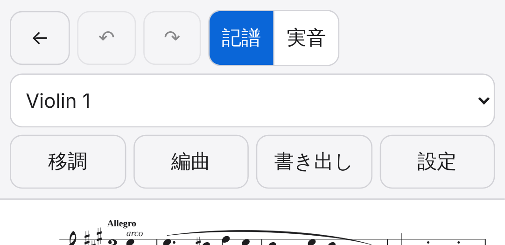

# 再検証報告書（2026-10-25、PR #3）

検証仕様：[`docs/verification/spec.md`](spec.md) ・ 前回の報告：[`report-2026-10-25.md`](report-2026-10-25.md) ・ 対象：PR #3 の最新 commit `87d20cf`（ブランチ `ccr-f80abe62-d5sp05`） ・ 検証担当：Claude Code

## 結論

**合格（条件付き）**。issue #2 の7件はすべて直っていて、検証テストも既存のテストもすべて通った。MVP の項目に S1・S2 の不具合は残っていないので、検証仕様のリリースの目安は満たす。

ただし、BUG-1 の直し方から新しい戻り（BUG-8、S3）が1件出た。小さな直しで済むので、同じ PR で直すのをすすめる。

## 実行した検証

| 段階 | 結果 |
| --- | --- |
| 検証テストが書き換えられていないか | 確認済み：`tests/verification/`・`docs/verification/` は前回の commit `99a750d` から変わっていない |
| 既存のテストの変更 | 妥当：`assets.test.ts` は不具合（分割された小節を警告に出す）を期待していた行を直したもの。e2e の2本は既定値の変更に合わせたものと待ち時間の延長で、テストを甘くしてはいない |
| L1 `npm run check` | 合格（単体テスト 141件） |
| L2 `npm run test:e2e` | 合格（79件、2件スキップ。前回と同じ理由） |
| L3 `npm run verify:logic` | **53件すべて合格**（前回 48件） |
| L4 `npm run verify:ui` | **29件すべて合格**、1件スキップ（UI-01 は PC では対象外）（前回 22件） |
| GitHub の CI | 合格 |
| 追加の確かめ（検証テストとは別に） | 下の表 |

### 追加の確かめ

| 確かめたこと | 結果 |
| --- | --- |
| 移調：全25音程（増・減を含む）× 15調 × 上下 × 途中の調 × 自動置換のオン／オフ、計12000通り | 例外0件、実音（MIDI番号）の誤り0件、♯・♭7つ超の調の残り0件 |
| 調を指定した移調：全15調 → ♯・♭6つ以下の全調 × 上下 × 途中の調15 | すべて指定した調になる |
| 「拍の合わない小節」の警告：4つの素材 | K.464・K.387・合成オーケストラは0件（分割された小節を数えない）。Beethoven Op.18-1 の2小節は元ファイルのとおり警告に出る |
| 本当に2拍しかない小節が1つ | 警告に出る |
| 本当に2拍しかない小節が2つ続く | **警告に出ない** → BUG-8 |
| スマホのツールバー（画像） | 3段に分かれ、どの部品も読めて押しやすい（下の画像） |

## 前回の不具合の確認

| ID | 判定 | メモ |
| --- | --- | --- |
| BUG-1【S2】 | 直った | IO-10 合格。K.464 を開いてそのまま書き出しても元と同じ |
| BUG-2【S3】 | 直った | TR-12（ロジック・画面）・TR-01 合格。調を五度圏の上で動かす直し方で、例外の元がなくなった |
| BUG-3【S3】 | 直った | UI-01 がスマホでも合格。画像でも確認 |
| BUG-4【S3】 | 直った | 色分けに「編曲元パートごと」と「自動」（編曲で作った楽譜だけ編曲元ごと）が加わった。仕様の既定どおり |
| BUG-5【S3】 | 直った | 移調パネルで「度数 × 種類 ＋ オクターブ」を選べる。既存の画面テストに確認が足された |
| BUG-6【S4】 | 直った | 実装を仕様に合わせ、既定を「示さない」にした。前回の報告書のおすすめ（仕様書を実装に合わせる）とは逆だが、仕様どおりなので合格。検証テストが仕様を期待していたのに報告書で逆をすすめたのは、検証側の書き方の誤り |
| BUG-7【S4】 | 直った | 仕様どおり `public/samples/LICENSE` を置いた（アプリ内のリンクは `LICENSE.txt` のまま） |

## 新しい不具合

### BUG-8【S3】本当に拍の足りない小節が2つ続くと、警告も休符の補いも出ない（BUG-1 の直しで生じた戻り）

- 検証項目：IO-11（今回追加。`tests/verification/logic/verify.test.ts`「IO-11 …」。修正前のコードでは合格、PR #3 では不合格）
- 再現手順：4/4 で、全音符・2分音符だけ・2分音符だけ・全音符の4小節を読み込む
- 期待：第2・3小節が拍の合わない小節として警告に出る。仕様「エラー処理」：拍が合わない小節は警告扱い。読み込み確認の「拍の足りない小節を休符で埋める」の対象にもなる
- 実際：警告が出ない。BUG-1 の直しでは「隣の小節と合わせてちょうど1小節になる短い小節」を分割された小節とみなすので、2拍＋2拍も分割された小節として扱われる
- 影響：読み取りソフト（OMR）の結果でよくある「拍の足りない小節」が続いた場合に見逃し、開いたあとも赤く表示されない
- おすすめの直し方：分割された小節とみなすのは、2小節の間に反復記号か括弧の切れ目があるとき、またはどちらかが番号を数えない小節（implicit）のときだけにする。K.464（第87小節は反復記号の終わり、次の X1 は implicit）と K.387 はこの条件で今と同じ結果になる

## 保留（前回から変わらず）

実機（iPhone・iPad・Android）、Safari、MuseScore での往復、再生音そのもの、本物の候補曲での確認、Googleドライブ（未実装）。特に BUG-3 のツールバーは、実機でも見てほしい。

## 追記：BUG-8 の再確認（commit `54d0d4d`）

**BUG-8 は直った**。ただし PR #3 は BUG-8 を直す前の `87d20cf` でマージされたため、**main（`e129bbc`）には BUG-8 が残っている**。修正の `54d0d4d` はブランチ `ccr-f80abe62-d5sp05` にあるだけなので、新しい PR で main に入れる必要がある。

| 確かめたこと | 結果 |
| --- | --- |
| 検証テストが書き換えられていないか | 確認済み（`a663d32` から変わっていない） |
| `npm run check` | 合格（141件） |
| `npm run test:e2e` | 合格（79件、2件スキップ） |
| `npm run verify:logic` | **54件すべて合格**（IO-11 を含む） |
| `npm run verify:ui` | 29件すべて合格、1件スキップ |
| 反復記号で分けた 2拍＋2拍（終わりの反復記号・始まりの反復記号） | 警告に出ない（正しい） |
| implicit で分けた 3拍＋1拍 | 警告に出ない（正しい） |
| 印のない 2拍＋2拍 | 警告に出る（正しい） |
| 反復記号があっても合わせて1小節にならない 2拍＋1拍 | 警告に出る（正しい） |
| 素材ごとの警告 | 前回と同じ（K.464・K.387・合成オーケストラは0件、Op.18-1 は2小節） |
