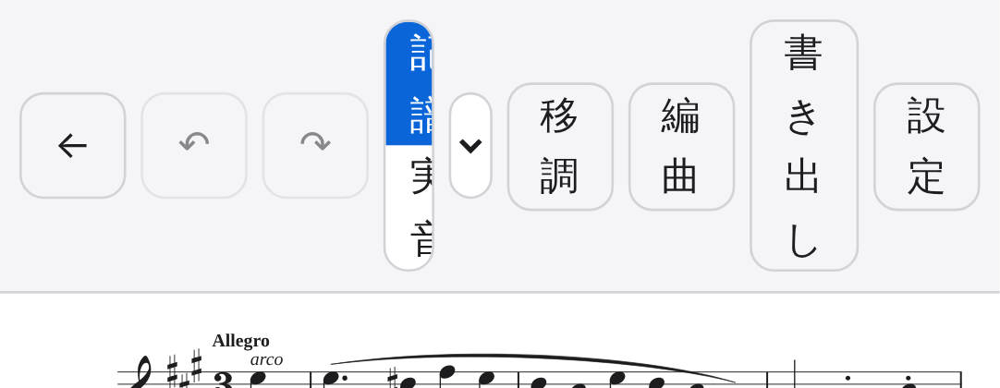

# 検証報告書（2026-10-25）

検証仕様：[`docs/verification/spec.md`](spec.md) ・ 対象 commit：`b1865dd`（main と同じ） ・ 検証担当：Claude Code

## 結論

**不合格（条件付き）**。MVP の項目に重大度 S2 の不具合が1件ある（BUG-1：正しい楽譜を開くだけで休符が足される）。これを直せば、この環境で確かめられる範囲では MVP の要求を満たす見込み。ほかに S3 が4件、S4 が2件。

| 段階 | 結果 |
| --- | --- |
| L1 静的・単体（`npm run check`） | 合格：型・lint・整形が通り、単体テスト 17ファイル・139件すべて合格 |
| L2 既存の画面テスト（`npm run test:e2e`） | 合格：76件合格、2件スキップ（タブレット・スマホでのキーボード操作。端末に合わないため意図どおり） |
| L3 検証者のロジック検証（`npm run verify:logic`） | 53件中48件合格、5件不合格（BUG-2 が2件、BUG-4・6・7） |
| L4 検証者の画面検証（`npm run verify:ui`） | 3画面サイズで30件中22件合格、7件不合格（BUG-1・2・3）、1件スキップ（UI-01 はタッチ端末だけ） |
| L5 実機 | 保留（実機がない） |

## 不具合

### BUG-1【S2】読み込み確認の既定のまま開くと、正しく書かれた小節に休符が足される

- 検証項目：IO-10（`tests/verification/ui/verify.spec.ts`「IO-10 …」、3画面サイズとも不合格）
- 再現手順：K.464（`test-assets/musicxml/mozart-k464-1-allegro.mxl`）を選ぶ → 読み込み確認の「拍の足りない小節を休符で埋める」が**既定でオン**のまま「楽譜を開く」→ すぐに MusicXML で書き出す
- 期待：元の楽譜と音符情報が同じ。仕様「エラー処理」：拍が合わない小節は**警告扱いにして、表示は続ける**
- 実際：第87小節（反復記号の終わり）の全4パートに4分休符が足される。この小節は3/4の小節を反復記号で「2拍＋1拍」に分けた前半（後半は次の小節 X1、読み込みでは弱起と同じ扱い）で、拍は足りていない。休符が入ると1拍余計になり、書き出し・再生のタイミングが原曲と変わる
- 原因の見立て：読み込みは、弱起（最初の小節）は数えない小節として扱うが、反復で分かれた小節の前半を「拍の数が合わない小節」として警告に出している（`src/core/musicxml/import.ts` の measure-length）。それをそのまま埋める対象にしている（`src/ui/ImportSummary.tsx`・`src/ui/App.tsx`）
- 影響：MuseScore などで作った普通の楽譜（反復記号で分かれた小節はよくある）で、利用者が気づかないまま楽譜が変わる。既存の画面テストはどれもこの既定の経路で開いているが、楽譜が変わったかは見ていないので気づけない

### BUG-2【S3】「調を指定」の移調が、曲の途中に別の調があると失敗し、画面に何も出ない

- 検証項目：TR-12（ロジック：`verify.test.ts`「TR-12 …」、画面：`verify.spec.ts`「TR-12 …」）
- 再現手順：Aメジャー（♯3）で始まり、第2小節で G♭メジャー（♭6）に転調する楽譜を開く → 移調 → 移調先の調「C♭メジャー（♭7つ）」→「移調する」
- 期待：移調される（仕様「曲の途中の転調は、調号の区間ごとに移調する」「♯または♭7つを超える場合は異名同音の調に置き換える」）
- 実際：何も起きない。メッセージも出ず、ブラウザのコンソールに例外「移調すると変化記号が ±2 を超えます」
- 範囲：全15調 → 全15調 × 上下 × 途中の調15 の 6750通りのうち 120通り。どれも移調先か途中の調が♯・♭6〜7つのとき
- 原因の見立て：区間の調を移調するとき（`src/core/transpose/transpose.ts` の `sectionInterval` → `transposeKey`）、調の主音の変化記号が ±2 を超えると例外になる。音符の方は異名同音に書き換える処理（`transposeSpelled`）があるが、調にはない
- 同じ原因：C♭メジャーで増2度下げ・減7度上げると例外（TR-01。画面の音程の一覧にこの2つはないので、画面からは起きない）

### BUG-3【S3】スマホではツールバーが詰まり、「表示するパート」と「記譜／実音」が読めない

- 検証項目：UI-01（`verify.spec.ts`「UI-01 …」、スマホで不合格。タブレットは合格）
- 再現手順：Pixel 7 の画面サイズ（幅412px）で楽譜を開く
- 期待：仕様「全端末共通」：タップ対象は44px以上
- 実際：「表示するパート」の選択欄が幅18px（矢印だけで、どのパートを表示中か見えない）、「記譜」「実音」が幅37px・36pxで文字が切れる。「書き出し」は1文字ずつ縦に4行に折れる

### BUG-4【S3】色分けに「編曲元パートごと」がない

- 検証項目：UI-09（`verify.test.ts`「UI-09 色分けに…」）
- 期待：仕様「表示オプション」：色分け＝なし／楽器ごと／編曲元パートごと、既定は「編曲画面のみ編曲元パートごと」
- 実際：選択肢は「なし」「楽器ごと」だけ（`src/ui/settings.ts` の `colorBy`）。`docs/dev-plan.md` のステップ2で「編曲元の色分けは各機能のステップで足す」とあるが、ステップ6cの結果に入っていない

### BUG-5【S3】移調の音程を仕様どおりに選べない（コードを読んで確認）

- 期待：仕様「移調の細則」：音程は「完全・長・短・増・減 × 1〜8度＋オクターブ数」で指定できる
- 実際：移調パネルの音程は13種（短2度〜完全8度、増4度・減5度）だけ。ほかの増・減の音程と、オクターブを足した音程（長9度など）は選べない（`src/ui/TransposePanel.tsx` の `INTERVALS`）。曲の中の移調処理そのものはこれらの音程にも対応している（TR-01）
- この項目は検証テストではなくコードを読んで確認した

### BUG-6【S4】「手で直した音」の表示の既定値が仕様と違う

- 検証項目：UI-09（`verify.test.ts`「UI-09 既定値が…」）
- 期待：仕様「表示オプション」：手直しした音の表示＝既定は「つけない」
- 実際：既定は「色で示す」。`docs/dev-plan.md` 6c には「色で示す（既定）」と書かれているが、仕様書は直っていない（進め方のルール「仕様を変えたら、先にこの仕様書を直してから」）。どちらに合わせるかは実装側の判断

### BUG-7【S4】音源のライセンスのファイル名が仕様と違う

- 検証項目：PB-03（`verify.test.ts`「PB-03 …」）
- 期待：仕様「再生音源」：`public/samples/LICENSE` に記録
- 実際：`public/samples/LICENSE.txt`。中身（FluidR3_GM・MIT）とアプリ内の表示・リンクは問題ない（画面の PB-03 は合格）。仕様書の方を直せば済む

## 項目ごとの判定

| ID | 判定 | 根拠・メモ |
| --- | --- | --- |
| IO-01 | 合格 | 全4素材で往復しても音符情報・小節数・調号・拍子・音部記号が同じ |
| IO-02 | 合格 | B♭クラ・E♭ホルンが `<transpose>`（-2/-1、-9/-5）付きで、記譜音で書き出される |
| IO-03 | 合格 | 20MB+1 バイトで「20MBまで」の理由。20MB ちょうどは大きさでは断らない |
| IO-04 | 合格 | 壊れた .mxl・MusicXML でないファイル・PDF・壊れた XML で理由が出る |
| IO-05 | 合格 | 未対応の要素は「読み込まなかった要素」に出て、読み込みは続く。改段（print）は「意図して使わない要素」 |
| IO-06 | 合格 | 拍の多すぎる小節も読み込まれ、警告が出る |
| IO-07 | 合格 | 既存の画面テスト |
| IO-08 | 合格 | 歌詞・コード記号・運指が書き出しに残る。数字付き低音（figured-bass）も残る |
| IO-09 | 合格 | 既存の画面テスト（v3） |
| IO-10 | **不合格** | BUG-1 |
| TR-01 | 条件付き合格 | 15調×20音程×上下の 600通りで、往復の完全一致・MIDI 番号・度数を確認。実際の3曲も完全一致。C♭メジャーの2通りだけ例外（BUG-2 と同じ原因、画面からは起きない） |
| TR-02 | 合格 | 自動置換オンの往復で MIDI 番号が一致 |
| TR-03 | 合格 | E→（長3度上）→ A♭、オフなら G♯（♯8）。ちょうど7つ（C♯）はそのまま |
| TR-04 | 合格 | ロジックと既存の画面テスト |
| TR-05 | 合格 | Aクラ 短3度上、F管ホルン 完全5度上、B♭トランペット 長2度上、E♭アルトサックス 長6度上 |
| TR-06 | 合格 | 移調楽器5種 × 15調で、記号の少ない方・同数なら♯系。♯系／♭系の指定も効く |
| TR-07 | 合格 | 打楽器は移調されない |
| TR-08 | 合格 | 範囲の頭と直後に調号の変更が入る |
| TR-09 | 合格 | 転調の区間ごとに移調される |
| TR-10 | 合格 | 元のパートは残り、和音から最高音を拾う |
| TR-11 | 合格 | 既存の画面テスト |
| TR-12 | **不合格** | BUG-2 |
| RG-01 | 合格 | 木管5種の実用音域が仕様の表どおり |
| RG-02 | 合格 | 音域外を見つけ、オクターブの候補を出す。端の音は音域内 |
| ED-01 | 合格 | 101回のうち100回戻れる |
| ED-02 | 合格 | 上書き方式。小節の拍の合計は変わらない |
| ED-03 | 合格 | 直前の音に最も近いオクターブ |
| ED-04 | 合格 | フルートでは和音にならず理由が出る。ピアノは和音になる |
| ED-05 | 合格 | 挿入・削除は全パート同時。先頭を消しても拍子・調号が残る |
| ED-06 | 合格 | 調号を変えても MIDI 番号が同じ |
| ED-07 | 合格 | 拍子を変えても音は動かず、拍の過不足が警告に出る |
| ED-08 | 合格 | 足りない小節は休符で埋まり、多すぎる小節は切られない |
| ED-09 | 合格 | 手で直した音は origin: edited |
| ED-10 | 合格 | 既存の画面テスト（PC のキーボード、タッチの鍵盤パネル） |
| ST-01 | 合格 | schemaVersion あり、往復で楽譜が同じ。新しい版・壊れた JSON は断る |
| ST-02 | 合格 | 既存の画面テスト |
| ST-03 | 合格 | 保存ごとに revision が1つ増え、保存した端末が記録される |
| AR-01 | 条件付き合格 | K.387（アイネ・クライネの代わり）で5楽器のパートができ、全小節に区間がある |
| AR-02 | 合格 | 生成した音に和音なし |
| AR-03 | 合格 | 生成音はすべて origin: generated と derivedFrom を持つ |
| AR-04 | 合格 | 音域外は5%未満で、すべて警告に出る |
| AR-05 | 合格 | 閾値が仕様どおり。跳躍はちょうど1オクターブを数えない、息継ぎは16秒で出る |
| AR-06 | 合格 | 区間全体・1楽器の作り直しとも、手で直した音が残る |
| AR-07 | 合格 | 合成オーケストラでティンパニ・打楽器は割当に出ない |
| AR-08 | 合格 | 既存の画面テスト |
| PB-01 | 合格 | 繰り返しは再生の順番だけ展開、楽譜の小節数は変わらない |
| PB-02 | 合格 | スタッカートは50%（普通の音は95%）、フェルマータは1.5拍分で後ろもずれる |
| PB-03 | 条件付き合格 | アプリ内表示とライセンス全文は合格。ファイル名だけ違う（BUG-7） |
| PB-04 | 合格 | 既存の画面テスト |
| PDF-01 | 合格 | 既存の画面テスト（画面の大きさで PDF が変わらない） |
| PDF-02 | 合格 | 既存の画面テスト |
| UI-01 | **不合格** | BUG-3（スマホ）。タブレットは合格 |
| UI-02 | 合格 | 3画面サイズとも画面下端に固定、スクロールしても動かない |
| UI-03 | 合格 | 3画面サイズ・各パネルでページ全体の横スクロールなし。ただしスマホのツールバーは詰まっている（BUG-3） |
| UI-04 | 合格 | PC・タブレットは総譜、スマホはパート譜 |
| UI-05 | 合格 | 音名・配色の設定がリロード後も残る |
| UI-06 | 合格 | 3画面サイズで読み込み→移調→編集→書き出しが通り、書き出しを読み戻すと B♭メジャーで、編集した1音だけが1オクターブ上（休符の違いは BUG-1） |
| UI-07 | 合格 | 上の一連の操作でコンソールのエラーなし |
| UI-08 | 合格 | 既存の画面テスト |
| UI-09 | **不合格** | BUG-4・BUG-6。ほかの既定値は仕様どおり |
| PF-01 | 合格 | 合成オーケストラ500小節のファイル選択〜最初の楽譜表示：PC 2.7秒・タブレット 3.0秒・スマホ画面 2.9秒（目標 PC 5秒）。ヘッドレス Chromium の値で、スマホ実機は保留 |
| PF-02 | 合格 | 曲全体の移調 13ms（目標 1秒） |
| PF-03 | 合格 | 編曲案：ロジック 0.23秒、画面でボタンから切り替わりまで PC 0.42秒・スマホ画面 0.57秒（目標 PC 3秒） |
| PF-04 | 合格 | 編集反映の中央値：PC 56ms・タブレット 65ms・スマホ画面 80ms（目標 PC 0.2秒・スマホ 0.3秒） |

## 保留・未実装

| 項目 | 状態 | 理由・次にやること |
| --- | --- | --- |
| 実機（iPhone・iPad・Android）での表示・操作・速さ | 保留 | 実機がない。特に BUG-3 は実機でも確かめたい |
| Safari（WebKit） | 保留 | この環境は Chromium のみ。PDF が iPhone で同じ見た目になるか（ステップ5の完了条件）も未確認 |
| MuseScore での往復 | 保留 | `mscore3` がない |
| 再生音が聞こえるか・音色のバランス | 保留 | 音を聞けない。再生イベント列（PB-01・02）と画面の反応（PB-04）で代えた |
| 本物の候補曲（運命・アイネ・クライネ・K.331） | 保留 | CC0 データが未入手。代わりの素材で確認した（AR-01・TR-01・PF-01 は「代替で確認」） |
| Googleドライブ保存・共有（ステップ8） | 未実装 | v2 の機能。不合格にはしない |

## 検証テストの置き場所

- ロジック：`tests/verification/logic/verify.test.ts`（道具は `helpers.ts`）。`npm run verify:logic`
- 画面：`tests/verification/ui/verify.spec.ts`（書き出しの照合は `compare-export.ts`）。`npm run verify:ui`
- どちらも CI（`npm run check`・`npm run test:e2e`）には入れていない。型・lint・整形は CI の対象（通ることを確認済み）
- 不合格のテストは不具合を示すためにそのまま残している。直ったら通るはずなので、実装側で既存のテストへ移してよい
